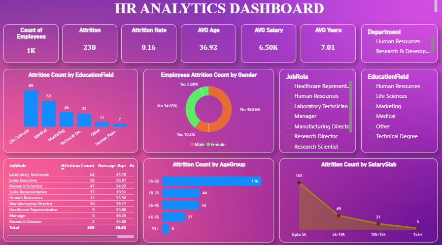

📊 HR Analytics Dashboard Using Power BI

📌 Project Overview

This project focuses on analysing employee data to understand workforce trends, employee attrition, and key HR metrics through an interactive dashboard developed using Microsoft Power BI.

The main objective of this project is to identify employee attrition patterns and transform raw HR data into meaningful insights that can support better workforce planning and business decision-making.

🎯 Project Objectives

- Analyse employee data and workforce trends.
- Understand employee attrition patterns.
- Identify departments with higher attrition rates.
- Analyse attrition based on gender, age, education, and job roles.
- Evaluate salary-based attrition trends.
- Present meaningful insights through interactive visualisations.

🛠️ Tools & Technologies Used

- Microsoft Power BI
- Data Cleaning
- Data Transformation
- Data Analysis
- DAX Measures
- Data Visualization
- Interactive Dashboard Design

📊 Key Performance Indicators (KPIs)

The dashboard includes the following key metrics:

- Total Employee Count
- Total Attrition Count
- Attrition Rate

📈 Dashboard Features & Analysis

- **Department-wise Attrition:** Analyse employee attrition across different departments.
- **Gender-wise Attrition:** Understand attrition patterns based on gender.
- **Education Field-wise Attrition:** Analyse attrition across different educational backgrounds.
- **Job Role-wise Attrition:** Identify job roles with higher employee attrition.
- **Age Group-wise Attrition:** Understand attrition trends across different age groups.
- **Salary Slab-wise Attrition:** Analyse employee attrition based on salary categories.
- **Interactive Slicers:** Filter and explore data based on department, job role, education field, and other available filters.

🧹 Data Preparation & Transformation

The project involves preparing employee data for analysis using Power BI.

The data preparation process includes:

- Understanding the dataset structure.
- Data cleaning and transformation.
- Preparing data for analysis.
- Creating calculated measures for key HR metrics.
- Building interactive visualisations.

💡 Key Learnings

Through this project, I gained practical experience in:

- Analysing employee attrition patterns.
- Working with Power BI.
- Transforming raw data into meaningful insights.
- Creating KPI measures using DAX.
- Designing interactive dashboards.
- Understanding how data analytics supports HR decision-making.

🖥️ Dashboard Preview



📁 Project Structure

```text
HR-Analytics-Dashboard/
│
├── HR_Analytics_Dashboard.pbix
├── HR_Analytics_Dataset.xlsx
├── HR_Analytics_Dashboard.png
└── README.md
```

🚀 How to Use This Project

1. Download the Power BI dashboard file from this repository.
2. Open the `.pbix` file using Microsoft Power BI Desktop.
3. Explore the dashboard and available visualisations.
4. Use the interactive slicers to analyse different employee segments.

👩‍💻 Author

**Madhumitha**

Aspiring Data Analyst | ECE Graduate

**Skills:**
- Microsoft Excel
- SQL
- Python
- Power BI
- Data Analysis
- Data Visualization

📬 Connect With Me

LinkedIn: https://www.linkedin.com/in/madhumitha-m-a4624232a/

GitHub: https://github.com/MadhumithaM2003

---

⭐ If you find this project useful, feel free to star this repository!
